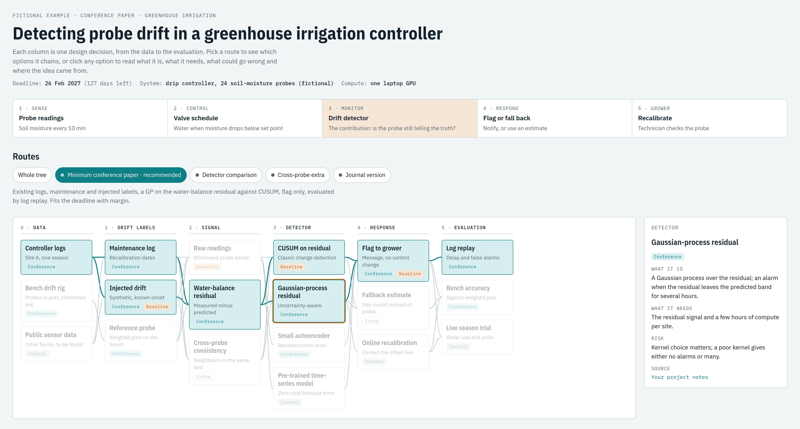

# research-decision-tree

A Claude skill that turns your notes, roadmap and annotated papers into an interactive **decision tree of your paper or thesis**. It shows every design option, what each one needs, its risks and where the idea came from, plus the route that fits your deadline.



## Install

### Claude Code: let Claude do it

Paste this into Claude Code:

```
Install the skill from https://github.com/11inaki11/research-decision-tree: clone the repo to a temp folder and copy skills/research-decision-tree into ~/.claude/skills/
```

Then restart Claude Code (or open a new session).

### Claude Code: by hand

```bash
git clone https://github.com/11inaki11/research-decision-tree.git
cp -r research-decision-tree/skills/research-decision-tree ~/.claude/skills/
```

### claude.ai

1. Download this repo (**Code → Download ZIP**) and unzip it.
2. Zip only the folder `skills/research-decision-tree`.
3. Upload that zip in **Settings → Capabilities → Skills**.

## Use

Type `/research-decision-tree`, or just ask, for example:

```
Build a decision tree of the options for my paper. My notes are in notes.md and the deadline is 15 March.
```

```
Hazme un árbol de decisión de mi TFM con mis notas de docs/, entrego en junio.
```

```
We decided to drop the second dataset. Update the tree.
```

Claude asks for your sources if you give it very little, builds one HTML page, and then asks you only the few decisions that are yours to make.

## License

MIT. The example project is fictional.
